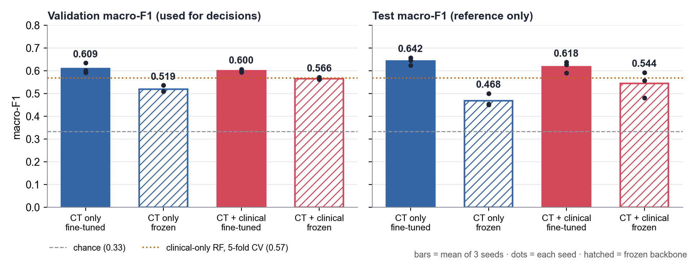
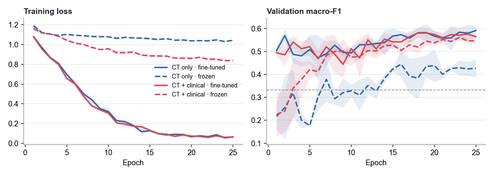

# 冻结骨干 vs 全部微调 —— 对比实验

**问题：** 把 ResNet-18 骨干全部冻结、只训练后面的层，能不能缓解基线的过拟合？

**结论：** 不能。全部冻结后模型反而**欠拟合**：训练 loss 降不下去，验证集 F1 明显下降（只用 CT 的模型 -0.091，融合模型 -0.034）。
ImageNet 学到的特征不能直接用在 CT 上，骨干至少要做部分微调。

## 实验设置

两组只差「骨干是否冻结」和学习率，其余完全相同。

| | 全部微调（基线） | 冻结骨干 |
|---|---|---|
| ResNet-18 骨干 | 全部参与训练 | 全部冻结，BatchNorm 统计量也固定 |
| 训练的部分 | 骨干 + 分类头（+ 临床分支） | 只训练分类头（+ 临床分支） |
| 学习率 | 1e-4 | 1e-3（只训练分类头时通常用更大的学习率） |
| 其他 | 25 个 epoch · AdamW · 类别加权损失 · 基础增强（旋转 ±10°、平移 ±5%） · 同一数据划分 · 种子 0/1/2 | 同左 |

**选模型的规则不变：** 每个 epoch 看验证集 macro-F1，保留最好的那一轮；比较不同方案**只看验证集**，测试集分数只作参考。

## 结果总表（3 个种子的均值 ± 标准差）

| 配置 | 训练参数量 | 验证集 macro-F1 | 测试集 macro-F1 | 测试集平衡准确率 | 最后一轮训练 loss | 最佳 epoch（3 个种子） | 每次耗时（分钟） |
|---|---|---|---|---|---|---|---|
| 只用 CT · 全部微调 | 11,242,563 | **0.609 ± 0.018** | 0.642 ± 0.014 | 0.647 ± 0.009 | 0.07 | 18, 19, 18 | 3.3 |
| 只用 CT · 冻结骨干 | 66,051 | **0.519 ± 0.013** | 0.468 ± 0.022 | 0.477 ± 0.021 | 1.04 | 20, 7, 16 | 1.5 |
| CT + 临床 · 全部微调 | 11,255,747 | **0.600 ± 0.005** | 0.618 ± 0.020 | 0.623 ± 0.023 | 0.06 | 22, 18, 8 | 3.3 |
| CT + 临床 · 冻结骨干 | 79,235 | **0.566 ± 0.004** | 0.544 ± 0.046 | 0.558 ± 0.023 | 0.84 | 23, 23, 9 | 1.5 |

对照：随机猜的 macro-F1 是 0.333；只用临床数据的随机森林，5 折交叉验证约 0.569。



## 训练过程



- **实线（全部微调）：** 训练 loss 很快降到接近 0，验证集 F1 却停在 0.6 左右，说明在**过拟合**。
- **虚线（冻结骨干）：** 训练 loss 只降到 1.04（只用 CT）和 0.84（融合），连训练集都学不好，说明是**欠拟合**。

## 各类别召回率（测试集，3 个种子平均）

| 配置 | Aspergillus | Non-Asp. fungi | Non-fungal |
|---|---|---|---|
| 只用 CT · 全部微调 | 67% | 56% | 71% |
| 只用 CT · 冻结骨干 | 41% | 37% | 66% |
| CT + 临床 · 全部微调 | 61% | 53% | 73% |
| CT + 临床 · 冻结骨干 | 61% | 49% | 57% |

只用 CT 的模型冻结之后，曲霉的召回率从 67% 降到 41%，其他真菌从 56% 降到 37%，非真菌只从 71% 降到 66%。也就是说，冻住的特征最分不清的是两类真菌。

## 怎么理解

1. **两个极端都不好。** 全部微调约 1,124 万个参数，在约 400 个训练病人上会死记训练集；全部冻结只训练约 6.6 万个参数，又学不到区分这三类 CT 所需的特征。合适的做法在两者之间。
2. **冻结后，融合比只用 CT 高。** 因为临床分支仍在训练。冻结版融合的验证集 F1（0.566）和只用临床的随机森林（0.569）差不多，说明这时候主要是临床数据在起作用，冻住的 CT 特征贡献很少。
3. **冻结的好处只有速度。** 每次训练从约 3.3 分钟降到约 1.5 分钟，但代价是准确率明显下降。

## 局限

- 冻结版只试了一组设置（学习率 1e-3、25 个 epoch）。它的训练 loss 到最后还在缓慢下降，多跑几轮或调大学习率可能会好一些，但要追上全部微调的可能性不大。
- 测试集只有 83 例，测试集分数的波动比验证集大（冻结版融合模型的标准差达到 0.046），所以结论以验证集为准。

## 下一步建议

**部分冻结：** 冻结前面的层（它们学的是边缘、纹理这类通用特征），只训练最后一层（`layer4`），或最后两层（`layer3` + `layer4`），预计每次 2–3 分钟。这也是 PPT 第 12 页「partial freezing」要做的事。

## 复现

```
python src/train_ct.py --mode ct --seed 0 --freeze --lr 1e-3        # 冻结版，seed 0/1/2，--mode ct/fusion
python src/report_freeze.py                                         # 重新生成本文件和两张图
```

结果文件：`results/*_aug-basic_seed*_frozen-lr0.001.json`；基线结果：`results/*_aug-basic_seed*.json`（未改动）。
